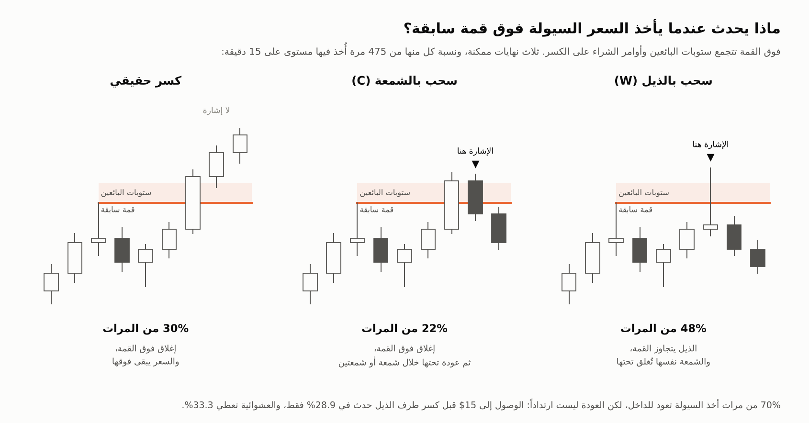
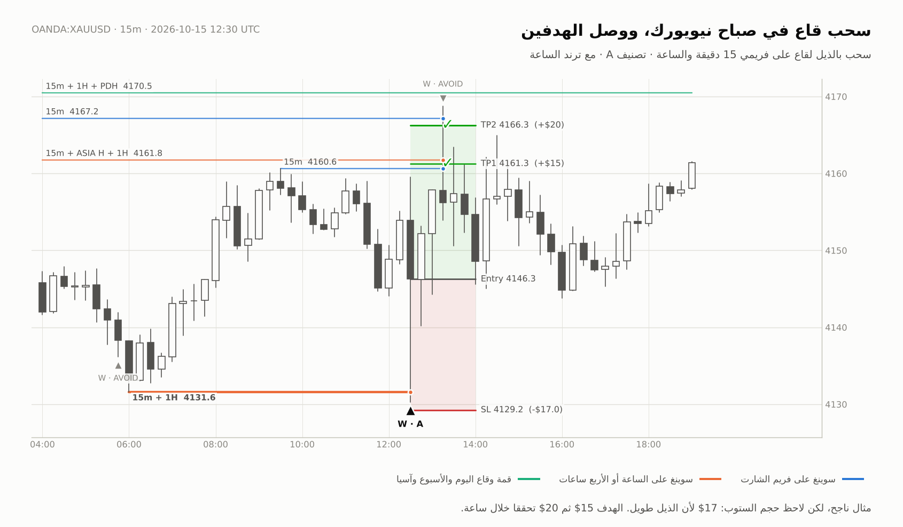
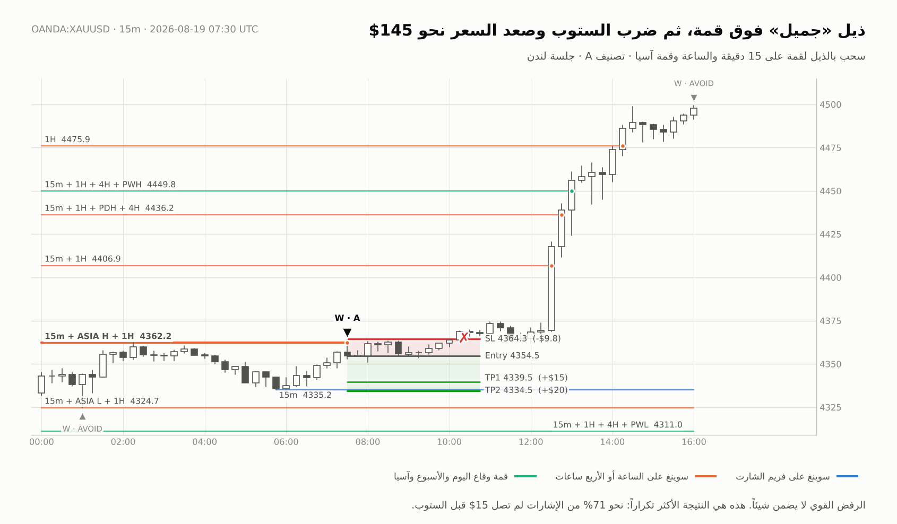
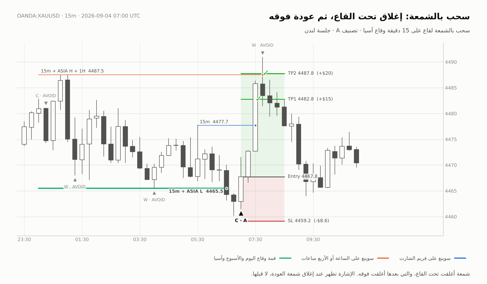
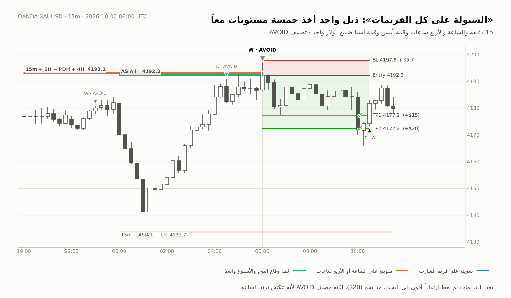
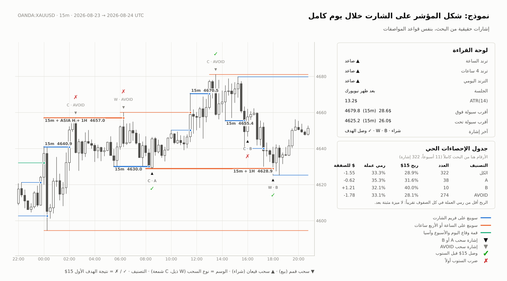

# مؤشر «خريطة السيولة» للذهب (XAUUSD): البحث والمواصفات الكاملة

> ملف مُعدّ ليُقدَّم إلى **Claude Fable** لبناء مؤشر على TradingView (Pine Script v6) بالتعاون مع المتداول.
> تاريخ البحث: 21 أكتوبر 2026. البيانات: `OANDA:XAUUSD` من TradingView.
> كل رقم في هذا الملف يمكن إعادة إنتاجه بأمر واحد: `python research/run_study.py`

---

## 0. الملخص في دقيقة

**الفكرة كما قالها المتداول:** على فريم 15 دقيقة يأخذ الذهب السيولة بذيل أو بشمعة، أي يكسر قمة أو قاعاً سابقاً، ثم يرتد. وارتداد 15 إلى 20 دولاراً يكفي.

**ما الذي اختبرناه:** كل مرة تجاوز فيها السعر مستوى سيولة ثم أغلق راجعاً إلى الداخل. مستويات السيولة هي قمم وقيعان على 15د و1س و4س، وقمة وقاع اليوم والأسبوع السابقين، ونطاق جلسة آسيا. وجدنا 322 حالة على 15د خلال 11 أسبوعاً. ثم أعدنا الاختبار نفسه على فترتين لم نستخدمهما في بناء أي فرضية: 30د من يناير إلى يوليو 2026، و1س لعام 2025 كاملاً.

**النتيجة:**

1. ✅ **أخذ السيولة ثم العودة ظاهرة حقيقية وثابتة.** في نحو 70% من المرات التي يتجاوز فيها السعر مستوى سيولة، يُغلق راجعاً إلى الداخل خلال 3 شموع. تكرر ذلك في العينات الثلاث (70.3% و72.6% و69.9%).
2. ❌ **لكن الارتداد بعد السحب ليس أفضل من رمي عملة.** وصل السعر إلى ‎+15$‎ قبل أن يتجاوز طرف الذيل بدولار في 28.9% من الحالات، بينما العشوائية البحتة تعطي 33.3% بنفس المسافات. وحتى بلا ستوب إطلاقاً، وصل خلال 4 ساعات في 40.4% مقابل 47.7% لدخول عشوائي في نفس الساعة ونفس الاتجاه.
3. ❌ **عكس كل سحب آلياً لم يتفوق على الدخول العشوائي في أي عينة.** بالدولار جاءت النتيجة سالبة في كل تركيبات الستوب والهدف التي جربناها، وفي 9 تعريفات مختلفة للسحب على 15د. وأفضل ما ظهر كان قريباً من الصفر (عينة 30د بوحدات ATR).
4. ⚠️ **لا يوجد فلتر يحوّل السحب إلى ميزة مثبتة إحصائياً.** أقل السياقات سوءاً هو السحب مع ترند الساعة في جلسة لندن أو صباح نيويورك. جاء موجباً قليلاً في العينات الثلاث، لكنه غير دال إحصائياً (t≈1.3).
5. ⛔ **سياقات سيئة باستمرار:** السحب في جلسة آسيا، والسحب قرب الأرقام المدوّرة (مضاعفات 50$)، وعكس الترند غالباً.

**ماذا يعني هذا للمؤشر:** لن نبني آلة إشارات شراء وبيع تَعِد بنسبة ربح. سنبني **أداة تقرأ الشارت بصدق**، تفعل الآتي:
- ترسم السيولة من عدة فريمات.
- تكشف السحب لحظة إغلاق الشمعة.
- تصنّف سياقه إلى A أو B أو «تجنّب» بحسب البحث.
- تعرض **جدول إحصاءات حياً** يقيس كل سحب: هل وصل الهدف قبل الستوب؟ ويقارن النتيجة بنسبة رمي العملة.

إن ظهرت ميزة حقيقية مع الوقت فسيُظهرها الجدول. وإن لم تظهر فالجدول يمنعنا من خداع أنفسنا.

**حدود البحث:** تاريخ 15د المتاح من TradingView 11 أسبوعاً فقط، من أغسطس إلى أكتوبر 2026. النتائج متسقة عبر 3 فترات و3 فريمات، لكن عينة 15د صغيرة. الملحق (ب) يشرح كيف نكبّر البيانات مع الوقت.

---

## 1. خريطة الملفات في المستودع

| الملف | المحتوى |
|---|---|
| `GOLD_LIQUIDITY_INDICATOR_SPEC.md` | هذا الملف: البحث، ومواصفات المؤشر، وبرومبت جاهز لـ Fable |
| `research/sweep_engine.py` | **المرجع المنطقي**: كل تعريف في هذا الملف مكتوب فيه بلغة بايثون. عند أي غموض يكون الكود هو الحكم |
| `research/run_study.py` | يشغّل البحث كاملاً ويكتب النتائج |
| `research/results/RESULTS.md` | كل جداول النتائج الخام بالإنجليزية |
| `research/results/signals_15m.csv` | **مفتاح الإجابة**: الإشارات الـ322 على 15د مع سياقها وتصنيفها ونتيجتها، للمطابقة مع مؤشر Pine |
| `research/data/*.csv` | بيانات `OANDA:XAUUSD` على فريمات 1m و15m و30m و1h و4h و1D |
| `research/tv_json_to_csv.py` | يحوّل بيانات TradingView MCP إلى CSV ويدمجها مع الموجود |
| `research/plot_examples.py` و`research/examples/*.png` | صور أمثلة حقيقية للسحب ونموذج لشكل المؤشر (البند 4.12) |

---

## 2. التعريفات الدقيقة (مصدر الحقيقة للبحث وللمؤشر)

### 2.1 مستويات السيولة

| الرمز | المستوى | طريقة الحساب | متى يصبح صالحاً (بلا نظر إلى المستقبل) | متى ينتهي |
|---|---|---|---|---|
| `P` | سوينغ على فريم الشارت | قمة أعلى **تماماً** من 5 شموع قبلها، وأعلى **أو تساوي** 5 شموع بعدها. والعكس للقاع | بعد إغلاق الشمعة الخامسة يمين القمة | عند أخذه |
| `P1H` | سوينغ الساعة | الفكرة نفسها على شموع الساعة، بطول 3 | بعد إغلاق شمعة الساعة الثالثة يمينه | عند أخذه |
| `P4H` | سوينغ 4 ساعات | الفكرة نفسها على شموع 4س، بطول 3 | بعد إغلاق شمعة 4س الثالثة يمينه | عند أخذه |
| `PD` | قمة وقاع اليوم السابق | اليوم التداولي يبدأ 17:00 بتوقيت نيويورك، مثل شموع TradingView اليومية | من أول شمعة في اليوم الجديد | نهاية اليوم |
| `PW` | قمة وقاع الأسبوع السابق | الأسبوع يبدأ الأحد 17:00 بتوقيت نيويورك | من أول شمعة في الأسبوع | نهاية الأسبوع |
| `ASIA` | قمة وقاع جلسة طوكيو | الشموع من 00:00 إلى 06:00 UTC | 06:00 UTC | نهاية اليوم التداولي |

قواعد عامة:
- يُضاف المستوى فقط إذا كان السعر في الجهة الصحيحة منه: القمة فوق آخر إغلاق، والقاع تحته (مقارنة صارمة).
- **يُستهلك المستوى عند أول مرة يتجاوزه السعر**، سواء كان ذلك سحباً أو كسراً حقيقياً. لا يُستخدم المستوى مرتين.
- لا يُعتبر مستوى من فريم أعلى تشكّل وكُسر قبل بداية البيانات.
- قد تجتمع عدة أنواع على السعر نفسه. مثال: قاع هو سوينغ على 15د وسوينغ على 1س وقاع آسيا في آن واحد. هذا هو «تعدد الفريمات»، ويظهر في عمود `kinds` (مثلاً `P+ASIA+P1H`).

### 2.2 الأخذ (Take)

الأخذ شمعة **افتُتحت** في الجهة القريبة من المستوى ثم تجاوزته: `high > level` في القمم، و`low < level` في القيعان. أما الشمعة التي افتُتحت أصلاً خلف المستوى (فجوة)، فتستهلكه بلا إشارة.

### 2.3 نوعا السحب

- **W، سحب بالذيل:** الشمعة نفسها تُغلق راجعة إلى الداخل، خلف **كل** المستويات التي أخذتها. في القمم مثلاً: `close < أدنى مستوى مأخوذ`.
- **C، سحب بالشمعة:** الشمعة تُغلق خلف المستوى (كسر)، ثم تُغلق إحدى **الشمعتين التاليتين** راجعة إلى داخل النطاق، أي تحت المستوى المرجعي في القمم وفوقه في القيعان. المستوى المرجعي هو أقرب مستوى مأخوذ. طرف السحب هو أعلى قمة (أو أدنى قاع) من شمعة الكسر حتى شمعة الإشارة.
- تُعطى إشارة واحدة لكل جهة في كل شمعة. إذا اجتمع W وC في الشمعة نفسها والجهة نفسها، تصبح إشارة واحدة من نوع `W+C`. طرفها هو الأبعد، ومرجعها هو الأقرب.
- إذا سحبت الشمعة الجهتين معاً (قمة وقاعاً)، فلا إشارة، لأنها غامضة. ومع ذلك تُستهلك المستويات.
- **الإشارة تُعطى عند إغلاق الشمعة فقط.**

### 2.4 خطة الصفقة الافتراضية (أداة القياس)

- **الاتجاه:** سحب القمم يعني بيعاً، وسحب القيعان يعني شراءً.
- **الدخول:** سعر إغلاق شمعة الإشارة. يبدأ الفحص من الشمعة التالية.
- **الستوب:** طرف السحب مع هامش 1$.
- **الأهداف:** 15$ و20$.
- **الوقف الزمني:** 32 شمعة (8 ساعات على 15د)، ثم الخروج على الإغلاق.
- **التكلفة:** 0.5$ لكل صفقة (سبريد وانزلاق).
- **ستوب وهدف في الشمعة نفسها:** إذا لمستهما شمعة واحدة معاً تُحسب الصفقة خسارة. هذا افتراض متحفّظ، ولم يحدث إلا في نحو 1% من الحالات.
- **الفجوات:** إذا قفز السعر فوق الستوب أو الهدف، يكون التنفيذ على سعر الافتتاح.

### 2.5 نسبة رمي العملة: لماذا لا تعني نسبة الربح وحدها شيئاً

في سوق بلا أي ميزة، احتمال الوصول إلى الهدف `T` قبل الستوب `S` هو `S / (S + T)`. مثال: ستوب 5$ وهدف 15$ يعطيان ربحاً في 25% من المرات بالعشوائية البحتة. لذلك لا قيمة لأي طريقة ما لم تتفوق على هذه النسبة **بعد التكاليف**. في كل جدول نقارن بمرجعين:
1. **نسبة رمي العملة** `S/(S+T)` لنفس الصفقات.
2. **دخول عشوائي:** 40 دخولاً عشوائياً لكل إشارة، في الساعة نفسها بتوقيت نيويورك، وبالاتجاه والستوب والهدف نفسها.

### 2.6 السياق

| الميزة | التعريف |
|---|---|
| الترند | موقع إغلاق شمعة الإشارة من EMA50 على شموع الساعة **المغلقة** قبل افتتاح شمعة الإشارة. تكون الصفقة «مع الترند» إذا كانت في جهته |
| الجلسة (بتوقيت نيويورك، حسب وقت افتتاح الشمعة) | آسيا 18:00–02:00، لندن 02:00–08:00، صباح نيويورك 08:00–12:00، بعد الظهر 12:00–17:00 |
| الرقم المدوّر | أي مستوى مأخوذ يبعد 3$ أو أقل عن مضاعف لـ50$ |
| ATR | ‏ATR(14) على فريم الشارت |

### 2.7 التصنيف (Grade)

| التصنيف | الشرط | المعنى |
|---|---|---|
| **AVOID** | جلسة آسيا، **أو** قرب رقم مدوّر، **أو** عكس الترند | سياقات خسرت في العينات الثلاث |
| **A** | ليس AVOID، **و**مع الترند، **و**في جلسة لندن أو صباح نيويورك | أقل السياقات سوءاً، **وليس ميزة مثبتة** |
| **B** | كل ما عدا ذلك | محايد |

---

## 3. نتائج البحث

استخدمنا ثلاث عينات منفصلة لم تُخلط ببعضها:

| العينة | الفترة | عدد الشموع | طبيعة السوق |
|---|---|---|---|
| 15 دقيقة (الأساسية) | 2 أغسطس إلى 21 أكتوبر 2026 | 5,270 | نطاق متذبذب بين 4,019$ و4,697$ |
| 30 دقيقة (خارج العينة) | يناير إلى يوليو 2026 | 6,869 | صعود حاد إلى 5,602$ ثم هبوط قوي |
| ساعة (خارج العينة) | 2025 كاملة | 5,915 | ترند صاعد قوي |

في العينتين الخارجيتين جعلنا الأهداف والستوبات بمضاعفات ATR لتكون المقارنة عادلة. فهدف 15$ على 15د يساوي تقريباً 2×ATR، لأن القيمة الوسيطة لـATR كانت 7.44$.

### 3.1 ماذا يحدث عندما يُؤخذ مستوى؟

| العينة | مرات الأخذ | عاد بالذيل | عاد خلال 1–2 شمعة | بقي خلف المستوى |
|---|---|---|---|---|
| 15د | 475 | 48.4% | 21.9% | 29.7% |
| 30د | 666 | 52.3% | 20.3% | 27.5% |
| 1س | 738 | 47.4% | 22.5% | 30.1% |

إذن **ملاحظتك صحيحة وصفياً**: نحو 70% من مرات أخذ السيولة تنتهي بإغلاق راجع إلى الداخل.

### 3.2 هل يرتد 15–20$ قبل أن يُكسر طرف الذيل؟ (15د)

| الهدف | حدث فعلاً | العشوائية تعطي |
|---|---|---|
| 10$ | 38.2% | 42.0% |
| 15$ | 28.9% | 33.3% |
| 20$ | 23.9% | 27.7% |

وهذه النتيجة بلا أي ستوب، أي: هل لمس السعر الهدف خلال 4 ساعات؟

| الهدف | بعد السحب | بعد دخول عشوائي |
|---|---|---|
| 10$ | 56.8% | 62.7% |
| 15$ | 40.4% | 47.7% |
| 20$ | 32.6% | 34.9% |

### 3.3 عكس كل سحب (15د، 322 صفقة، بعد خصم تكلفة 0.5$)

| الستوب | الهدف | نسبة الربح | رمي العملة | دخول عشوائي | $/صفقة | الفرق عن العشوائي | t |
|---|---|---|---|---|---|---|---|
| خلف الذيل +1$ | 15$ | 28.9% | 33.3% | 33.0% | −1.55 | −1.11 | −1.8 |
| خلف الذيل +1$ | 20$ | 23.9% | 27.7% | 27.2% | −1.43 | −1.12 | −1.6 |
| ثابت 10$ | 15$ | 35.7% | 40.0% | 39.5% | −1.48 | −0.92 | −1.4 |
| ثابت 10$ | 20$ | 30.1% | 33.3% | 32.8% | −1.29 | −0.88 | −1.1 |

- **العينتان الخارجيتان:** الاتجاه نفسه. الفرق عن العشوائي في 30د بين −0.9 و−3.9 دولار للصفقة، وفي 1س بين −0.6 و−1.2.
- **9 تعريفات مختلفة للسحب على 15د:** جرّبنا سوينغ بطول 3 و5 و8 شموع، مع نافذة سحب بالشمعة من 1 و2 و3 شموع. **كلها سالبة**، بفرق بين −0.4 و−1.7 دولار للصفقة.
- **الترند (15د):** مع الترند 93 صفقة بمتوسط −0.62$ للصفقة. عكس الترند 229 صفقة بمتوسط −1.93$ للصفقة (t = −2.05).

### 3.4 الفلاتر: هل يوجد سياق ينجح؟

حددنا 25 فلتراً **مسبقاً**، ولم نعتبر الفلتر جيداً إلا إذا كان موجباً في العينات الثلاث معاً. الرقم المعروض هو الفرق عن الدخول العشوائي بوحدات ATR لكل صفقة، مع ستوب خلف الذيل وهدف 2×ATR:

| الفلتر | 15د | 30د | 1س | المجموع | t |
|---|---|---|---|---|---|
| كل السحوبات | −0.11 | +0.03 | −0.13 | −0.07 | −1.6 |
| مع الترند + لندن أو صباح نيويورك | +0.19 | +0.26 | +0.02 | **+0.12** | 1.3 |
| صباح نيويورك | 0.00 | +0.20 | +0.03 | +0.09 | 1.0 |
| مع الترند | +0.05 | +0.08 | −0.10 | −0.01 | −0.1 |
| عكس الترند | −0.18 | +0.02 | −0.15 | −0.09 | −1.8 |
| السحب في جلسة آسيا | −0.18 | −0.05 | −0.20 | **−0.14** | −2.0 |
| قرب رقم مدوّر (50$) | −0.25 | −0.11 | −0.46 | **−0.26** | −2.2 |
| مستوى فريم أعلى (1س/4س/يوم/أسبوع) | −0.18 | +0.07 | −0.19 | −0.06 | −0.9 |
| رفض قوي (إغلاق بعيد عن الذيل) | −0.31 | +0.13 | −0.17 | −0.10 | −1.4 |
| سحب عكس الحركة الأخيرة (pullback) | +0.32 | +0.18 | −0.07 | +0.11 | 1.0 |

الجدول الكامل للفلاتر الـ25 موجود في `research/results/RESULTS.md`.

ملاحظات صريحة:
- مع 25 فلتراً، يُتوقع **بالصدفة وحدها** أن يظهر فلتر أو اثنان موجبان في العينات الثلاث. قيمة t≈1.3 ليست دليلاً.
- **مستويات الفريمات الكبيرة لم تعطِ ارتداداً أقوى**، على عكس الشائع.
- **الرفض القوي لم يكن أفضل**، أي الذيل الطويل مع إغلاق بعيد. بل كان من الأسوأ على 15د.
- **السحب قرب الأرقام المدوّرة يفشل أكثر.** هذا يتوافق مع أبحاث Carol Osler (الملحق أ): أوامر وقف الخسارة تتجمع خلف الأرقام المدوّرة مباشرة، وضربها يسرّع الحركة ولا يعكسها.

### 3.5 التصنيف المقترح على البيانات (ستوب خلف الذيل، هدف 15$ أو 2×ATR)

| العينة | A | B | AVOID |
|---|---|---|---|
| 15د | 38 صفقة، −0.62$/صفقة، فرق +0.19 | 10 صفقات | 274 صفقة، −1.78$/صفقة، فرق −1.42 |
| 30د | 57 صفقة، +2.05$، فرق +3.42 | 12 | 402 صفقة، −1.90$، فرق −1.84 |
| 1س | 108 صفقات، +0.39$، فرق +0.68 | 10 | 380 صفقة، −1.78$، فرق −1.39 |

تنبيه: التصنيف بُني من جدول الفلاتر نفسه، فهذه الأرقام «داخل العينة» ولا تثبت شيئاً. الغرض منه شيئان: إبعاد الإشارات السيئة باستمرار، وAVOID وحدها تشكّل 85% من الإشارات، ثم ترك جدول الإحصاءات الحي يحكم على A.

**عدد الإشارات على 15د:** نحو 5.6 إشارة في اليوم، منها نحو 0.7 من نوع A.

### 3.6 تصحيح: هل «السحب نفسه يُسحب»؟

يُكسر طرف السحب بإغلاق خلال 4 ساعات في 65.5% من الحالات. لكن قمة أو قاع **أي شمعة عشوائية** يُكسر خلال المدة نفسها في 72.6%. أي أن طرف السحب ليس أضعف من غيره، ولا أقوى بشكل يُعتمد عليه.

والتداول مع الكسر بعد فشل السحب جاء غير موثوق:
- موجب في عينة 30د: من +1.95 إلى +8.53 دولار للصفقة، وt حتى 2.8.
- قريب من الصفر في 15د.
- سالب في 1س.

### 3.7 حدود البحث

- تاريخ 15د قصير: 11 أسبوعاً فقط. النتائج متسقة عبر 3 فترات و3 فريمات، لكنها ليست نهائية.
- الدخول محسوب على إغلاق الشمعة. من يدخل بأمر معلّق على المستوى نفسه قد يحصل على سعر مختلف.
- البيانات من OANDA. أسعار البروكرات الأخرى تختلف بسنتات وقد تصل إلى دولار، فقد تختلف بعض الإشارات.
- لم نفلتر الأخبار (CPI وNFP وFOMC). السبريد الفعلي وقت الأخبار والرول أوفر قد يتجاوز 0.5$.

---

## 4. مواصفات المؤشر (TradingView، Pine Script v6)

### 4.1 الهدف والفلسفة

الاسم المقترح **Gold Liquidity Map**، واختصاره GLM. مؤشر من نوع overlay، مصمم لفريم 15 دقيقة، ويعمل على أي فريم أصغر من الساعة.

يقوم بخمس مهام:
1. **يرسم السيولة** من عدة فريمات: 15د و1س و4س واليوم والأسبوع ونطاق آسيا.
2. **يكشف السحب** بنوعيه W وC عند إغلاق الشمعة.
3. **يقرأ السياق**: ترند 1س و4س واليومي، والجلسة، والأرقام المدوّرة، ثم يصنّف الإشارة إلى A أو B أو AVOID.
4. **يعرض خطة الصفقة**: الدخول، والستوب، والهدفين، ونسبة رمي العملة لهذه الصفقة بعينها.
5. **يقيس نفسه** عبر جدول إحصاءات حي لكل تصنيف، مقارنةً برمي العملة.

ما **لا** يفعله: لا يَعِد بنسبة ربح، ولا يعيد رسم الإشارات (no repaint)، ولا ينظر إلى المستقبل، ولا ينفّذ صفقات.

### 4.2 المدخلات (Inputs)

| المجموعة | الاسم | الافتراضي | الوصف |
|---|---|---|---|
| Levels | `swingLen` | 5 | طول السوينغ على فريم الشارت |
| Levels | `htfLen` | 3 | طول السوينغ على 1س و4س |
| Levels | `useP`, `useP1H`, `useP4H`, `usePD`, `usePW`, `useAsia` | true | تفعيل كل نوع من المستويات |
| Levels | `asiaSess` | `"0000-0600"` بتوقيت UTC | جلسة نطاق آسيا |
| Levels | `maxLevelsPerSide` | 200 | حد المصفوفة لكل جهة، ويُحذف الأقدم عند تجاوزه |
| Levels | `drawNearest` | 12 | عدد المستويات المرسومة لكل جهة (الأقرب إلى السعر) |
| Sweep | `candleBars` | 2 | نافذة السحب بالشمعة |
| Sweep | `minPen` | 0.0 | أدنى تجاوز للمستوى بالدولار |
| Sweep | `useW`, `useC` | true | تفعيل نوعي السحب |
| Plan | `stopBuf` | 1.0 | هامش الستوب خلف طرف السحب بالدولار |
| Plan | `targetMode` | `"$"` | وحدة الأهداف: `"$"` أو `"ATR"` |
| Plan | `tp1`, `tp2` | 15 / 20 | الأهداف بالدولار |
| Plan | `tp1Atr`, `tp2Atr` | 2.0 / 2.7 | الأهداف بمضاعفات ATR |
| Plan | `timeStop` | 32 | الوقف الزمني بالشموع |
| Plan | `cost` | 0.5 | تكلفة الصفقة في الإحصاءات |
| Context | `trendTF` | `"60"` | فريم الترند |
| Context | `trendLen` | 50 | طول EMA الترند |
| Context | `roundStep`, `roundTol` | 50 / 3 | الرقم المدوّر وهامش التسامح |
| Context | `avoidAsia`, `avoidRound`, `avoidCounter` | true | قواعد تصنيف AVOID |
| Stats | `statsFrom`, `statsTo` | 2000-01-01 / 2100-01-01 | نافذة زمنية للإحصاءات، تُستخدم للمطابقة مع البحث |
| Display | `showLevels`, `showSignals`, `showPlan`, `showStats`, `showDash` | true | خيارات العرض |
| Display | `showAvoid` | true | يعرض إشارات AVOID بلون باهت |
| Alerts | `alertMin` | `"A"` | أدنى تصنيف يُطلق تنبيهاً: `"A"` أو `"B"` أو `"ALL"` |

### 4.3 قراءة الفريمات الأعلى بلا إعادة رسم

القاعدة الأساسية: تُجلب كل بيانات الفريم الأعلى بهذا الشكل فقط:

```pinescript
f_htf(tf, expr) => request.security(syminfo.tickerid, tf, expr[1], lookahead = barmerge.lookahead_on)
```

بهذا تأتي القيمة من آخر شمعة **مغلقة** في الفريم الأعلى، وتظهر ابتداءً من أول شمعة 15د بعد إغلاقها. وهذا يطابق مرجع البايثون تماماً: في `add_features` تُؤخذ قيم الفريم الأعلى من الشموع التي أُغلقت قبل **افتتاح** شمعة الإشارة.

- **سوينغ 1س و4س:** تُحسب داخل `request.security` بدالة سوينغ مطابقة لتعريف البند 2.1، مع `[1]`، ويُجلب معها وقت شمعة السوينغ لأغراض الرسم. يُضاف المستوى **مرة واحدة** عند أول شمعة من شمعة الفريم الأعلى الجديدة (`ta.change(time("60")) != 0`) إذا لم تكن القيمة `na`.
- **قمة وقاع اليوم السابق:** `request.security(syminfo.tickerid, "D", [high[1], low[1]], lookahead = barmerge.lookahead_on)`. يُضافان عند أول شمعة من اليوم الجديد، وتنتهي صلاحيتهما عند `time_close("D")`.
- **الأسبوع السابق:** بالطريقة نفسها مع `"W"`.
- **نطاق آسيا:** يُتتبع على شموع الشارت داخل الجلسة `time(timeframe.period, asiaSess, "UTC")`، ويُضاف عند أول شمعة بعد نهاية الجلسة، وتنتهي صلاحيته عند `time_close("D")`.
- **EMA الترند:** `f_htf(trendTF, ta.ema(close, trendLen))`.
- **السوينغ:** يمكن استخدام `ta.pivothigh` و`ta.pivotlow` فقط إذا طابقت قاعدة التساوي في البند 2.1 (أعلى تماماً من اليسار، وأعلى أو يساوي من اليمين). وإلا تُكتب دالة يدوية صغيرة.

### 4.4 محرك المستويات

```pinescript
type Liq
    float  price
    int    side      // 1 = فوق السعر، -1 = تحت السعر
    string kind      // "P", "P1H", "P4H", "PD", "PW", "ASIA"
    int    born      // وقت شمعة المستوى، للرسم
    int    expiry    // na = لا ينتهي
    line   ln

var array<Liq> above = array.new<Liq>()
var array<Liq> below = array.new<Liq>()
```

ترتيب العمل في كل شمعة **مؤكدة** (`barstate.isconfirmed`) إلزامي، لأنه ترتيب المرجع نفسه:

1. أضف مستويات الفريمات الأعلى والمستويات التقويمية المتاحة عند افتتاح هذه الشمعة (`P1H` و`P4H` و`PD` و`PW` و`ASIA`)، بشرط الجهة الصحيحة مقارنةً بـ`close[1]`.
2. احذف المستويات المنتهية، أي التي `expiry <= time`.
3. افحص **السحوبات بالشمعة المعلّقة** من الشموع السابقة (C).
4. افحص **الأخذ الجديد** في كل جهة: إما W وإما كسر معلّق.
5. ادمج الإشارات، وطبّق قاعدة «الجهتان معاً تعني لا إشارة»، ثم صنّف وارسم وأطلق التنبيه.
6. حدّث الصفقات الافتراضية المفتوحة للإحصاءات، وهي التي بدأت في شموع سابقة فقط.
7. أضف سوينغات فريم الشارت التي تأكدت الآن، بشرط الجهة مقارنةً بـ`close`.

ملاحظات:
- دوال `ta.*` و`request.security` تُستدعى على مستوى الملف في كل شمعة، لا داخل الشروط. أما **استخدام** نتائجها فيكون داخل `if barstate.isconfirmed`.
- المستوى المأخوذ يُحذف من المصفوفة فوراً، سحباً كان أو كسراً.
- **الرسم:** خط أفقي من شمعة المستوى إلى الشمعة الحالية. عند الأخذ يتوقف الخط ويتغير نمطه: منقّط إذا سُحب، ومتصل باهت إذا كُسر. تُرسم فقط أقرب `drawNearest` مستويات لكل جهة، ويُعاد استخدام الخطوط بدل إنشاء خطوط جديدة، لأن الحد 500 خط.
- **الألوان ثلاث مجموعات فقط**: سوينغ فريم الشارت أزرق `#2a78d6`، وسوينغ 1س و4س برتقالي `#eb6834`، وقمة وقاع اليوم والأسبوع وآسيا أخضر مزرق `#1baf7a`. النوع الدقيق يُكتب في وسم بجانب الخط، مثل `15m + 1H + PDH  4193.1`. إذا اجتمعت عدة أنواع على السعر نفسه يُرسم خط واحد بلون أعلى نوع فيها، ويُكتب الوسم بكل الأنواع.
- في بيانات البحث بلغ أقصى عدد للمستويات النشطة 112 فوق السعر و172 تحته. وأقصى عدد ضمن 100$ من السعر كان 25 لكل جهة.

### 4.5 كشف السحب (يطابق `find_sweeps` في `sweep_engine.py`)

```text
لكل جهة s (1 = قمم، أي إشارة بيع؛ -1 = قيعان، أي إشارة شراء):

  -- أولاً: السحب بالشمعة (من كسور حدثت في شموع سابقة) --
  لكل كسر معلّق p في الجهة s:
      p.ext := max(p.ext, high) للقمم | min(p.ext, low) للقيعان
      إذا close < p.ref للقمم | close > p.ref للقيعان:
            إشارة C طرفها p.ext ومستوياتها p.levels، ثم احذف p
      وإلا إذا bar_index - p.bar >= candleBars: احذف p

  -- ثانياً: الأخذ الجديد --
  taken := مستويات الجهة s التي فيها high > price + minPen للقمم | low < price - minPen للقيعان
  احذف taken من المصفوفة
  crossed := من taken ما كان فيه open <= price للقمم | open >= price للقيعان   // الفجوات بلا إشارة
  إذا لم تكن crossed فارغة:
      ref := min(crossed.price) للقمم | max(crossed.price) للقيعان
      إذا close < ref للقمم | close > ref للقيعان:  إشارة W طرفها high أو low
      وإلا: أضف كسراً معلّقاً {ref, ext = high أو low, bar = bar_index, levels = crossed}

الدمج: W وC في الجهة نفسها تصبحان "W+C"، الطرف هو الأبعد والمرجع هو الأقرب.
إشارتان في الجهتين على الشمعة نفسها: تجاهل الاثنتين.
```

### 4.6 التصنيف

```text
trendDir  := 1 إذا كان close (إغلاق شمعة الإشارة) فوق EMA الساعة المغلقة، وإلا -1
withTrend := (اتجاه الصفقة == trendDir)
session   := بحسب ساعة نيويورك لوقت افتتاح الشمعة
nearRound := أي مستوى مأخوذ يبعد roundTol أو أقل عن مضاعف لـ roundStep

AVOID := (avoidAsia and session == آسيا) or (avoidRound and nearRound) or (avoidCounter and not withTrend)
A     := not AVOID and withTrend and session في {لندن، صباح نيويورك}
B     := كل ما عدا ذلك
```

### 4.7 العرض على الشارت

- **علامة الإشارة:** سهم ▼ فوق شمعة سحب القمم، وسهم ▲ تحت شمعة سحب القيعان. لون السهم داكن لـA وB، ورمادي باهت لـAVOID. **التصنيف يُكتب نصاً** بجانب السهم مع نوع السحب، مثل `W · A`. لا يُعتمد على اللون وحده.
- **الأخضر والأحمر محجوزان للنتيجة فقط**: خطوط TP و✓ بالأخضر، وخط SL و✗ بالأحمر. لا يُستخدمان لأي شيء آخر.
- **الأشكال المرجعية:** الصور في `research/examples/` (البند 4.12) هي الشكل المطلوب.
- **تلميح العلامة (Tooltip)** يعرض:
  - النوع (W أو C).
  - المستويات المأخوذة، مثل `PDH + 1H`.
  - الدخول.
  - الستوب ومسافته بالدولار.
  - TP1 وTP2.
  - نسبة رمي العملة `S/(S+T)` لكل هدف.
  - الجلسة والترند.
- **خطة الصفقة (اختياري):** خط للدخول، وستوب باللون الأحمر، وهدفان. تمتد الخطوط حتى تُحسم الصفقة أو ينتهي `timeStop`.
- **علامة الحسم:** ✓ عند الهدف، و✗ عند الستوب، و⌛ عند انتهاء الوقت.

### 4.8 جدول الإحصاءات الحي (أهم جزء)

كل إشارة داخل نافذة `statsFrom` إلى `statsTo` تفتح صفقتين افتراضيتين، واحدة لـTP1 وأخرى لـTP2. القواعد هي البند 2.4 بالضبط: الدخول على الإغلاق، والفحص من الشمعة التالية، والفجوة على سعر الافتتاح، ولمس الستوب والهدف في شمعة واحدة خسارة، والوقف الزمني خروج على الإغلاق، ثم خصم `cost`.

يوضع الجدول أسفل يمين الشارت:

| | العدد | ربح% TP1 | رمي عملة% | الفرق | $/صفقة | ربح% TP2 | رمي عملة% | $/صفقة |
|---|---|---|---|---|---|---|---|---|
| الكل | | | | | | | | |
| A | | | | | | | | |
| B | | | | | | | | |
| AVOID | | | | | | | | |

- **رمي عملة%:** متوسط `S/(S+T)` لنفس الصفقات.
- **الفرق:** ربح% ناقص رمي عملة%، بالنقاط. يكون أخضر فقط إذا تجاوز +5 نقاط **و**كان العدد 50 أو أكثر. يكون أحمر إذا كان أقل من صفر. ويكون رمادياً في غير ذلك.
- **سطر أسفل الجدول:** نطاق التواريخ وعدد الشموع، مع عبارة «الفرق ≤ 0 يعني لا ميزة».

### 4.9 لوحة القراءة (أعلى يمين الشارت)

- **الترند على 1س و4س واليومي:** ▲ أو ▼، بمقارنة السعر مع EMA50 للساعة وEMA50 لـ4س وEMA20 لليومي، كلها من شموع مغلقة.
- **الجلسة الحالية.**
- **‏ATR(14)** بالدولار.
- **أقرب سيولة فوق السعر:** سعرها ونوعها والمسافة إليها بالدولار. ومثلها أقرب سيولة تحت السعر.
- **آخر إشارة:** اتجاهها وتصنيفها وحالتها (مفتوحة أو ✓ أو ✗ أو ⌛).

### 4.10 التنبيهات

- `alert()` مع `alert.freq_once_per_bar_close` لكل إشارة تصنيفها في مستوى `alertMin` أو أعلى.
- **صيغة نص التنبيه:**
  `XAUUSD 15m | SELL | A | swept PDH+1H @ 4123.40 | entry 4120.10 | SL 4126.00 ($5.90) | TP1 4105.10 | TP2 4100.10 | coin-flip 28%/23%`
- `alertcondition()` ثابتة إضافية لحالتين: «أي سحب A»، و«أي سحب A أو B».

### 4.11 قواعد إلزامية

1. يبدأ الملف بـ`//@version=6`، ويُعرّف المؤشر بـ`indicator(..., overlay = true, max_lines_count = 500, max_labels_count = 500)`.
2. كل المنطق داخل `if barstate.isconfirmed`. دوال `ta.*` و`request.security` تُستدعى على مستوى الملف.
3. لا `lookahead_on` بدون `[1]`. ولا `request.security_lower_tf`.
4. لا تتغير أي إشارة بعد ظهورها، ولا تُرسم إشارة على شمعة سابقة.
5. لا أرقام ثابتة مخفية في الكود: كل رقم في الجداول أعلاه يكون Input.
6. يُنظَّم الكود في دوال مثل `f_addLevel` و`f_checkSweeps` و`f_grade` و`f_updateStats`، مع تعليقات مختصرة.
7. لا تُضاف ميزة غير موجودة هنا قبل سؤال المتداول.

### 4.12 أمثلة مصورة (بيانات حقيقية من البحث)

رُسمت كلها بالمحرك نفسه، وتُعاد بالأمر `python research/plot_examples.py`.

| الصورة | ماذا تُظهر |
|---|---|
|  | **الفكرة:** سحب بالذيل (48%) وسحب بالشمعة (22%) وكسر حقيقي (30%)، وأين تظهر الإشارة في كل حالة |
|  | **مثال ناجح، تصنيف A:** سحب قاع (15د + 1س) في صباح نيويورك، وتحقق الهدفان خلال 45 دقيقة. لكن الستوب كان 17$ |
|  | **مثال خاسر، تصنيف A:** ذيل رفض قوي فوق قمة (15د + 1س + آسيا)، ثم ضرب الستوب وصعد السعر نحو 145$. هذه النتيجة هي الأكثر تكراراً |
|  | **سحب بالشمعة:** إغلاق تحت قاع (15د + آسيا)، ثم إغلاق فوقه. الإشارة عند إغلاق شمعة العودة |
|  | **السيولة على كل الفريمات:** ذيل واحد أخذ 15د و1س و4س وقمة أمس وقمة آسيا ضمن دولار واحد. نجح هنا، لكنه AVOID لأنه عكس ترند الساعة |
|  | **نموذج المؤشر ليوم كامل:** المستويات، والإشارات مع التصنيف والنتيجة، ولوحة القراءة، وجدول الإحصاءات |

---

## 5. اختبارات القبول

| # | الاختبار | المعيار |
|---|---|---|
| 1 | الترجمة | يترجم على Pine v6 بلا أخطاء ولا تحذيرات |
| 2 | عدم إعادة الرسم | في Bar Replay على 15د، الإشارات لا تتغير ولا تختفي بعد إغلاق الشمعة |
| 3 | مطابقة الإشارات | على `OANDA:XAUUSD` فريم 15د، وفي الأيام المشتركة مع `research/results/signals_15m.csv` **بعد استبعاد أول أسبوعين من تاريخ الشارت**: 90% أو أكثر من أوقات الإشارات واتجاهاتها متطابقة |
| 4 | مطابقة التصنيف | 90% أو أكثر من الإشارات المتطابقة لها نفس `grade` |
| 5 | مطابقة الإحصاءات | الجدول الحي في نفس النافذة قريب من الأرقام المحسوبة من ملف المرجع (الجدول التالي) |
| 6 | التنبيهات | تنبيه واحد لكل إشارة مؤهلة، عند إغلاق الشمعة فقط |
| 7 | الأداء | يعمل على 15د بلا خطأ «loop takes too long» وبلا تجاوز لحدود الرسم |

**لماذا نستبعد أول أسبوعين؟** المؤشر يبدأ بلا مستويات عند أول شمعة في الشارت. أما مرجع البايثون فكان يعرف مستويات الفريمات الأعلى القديمة التي لم تُكسر. لهذا قد تغيب إشارات قليلة في البداية، ومنها ما يكون مستواه الوحيد مستوى قديماً من 1س أو 4س.

**أرقام المرجع للمطابقة**، بالإعدادات الافتراضية: ستوب خلف الذيل +1$، وقف زمني 32 شمعة، تكلفة 0.5$:

| النافذة | التصنيف | العدد | ربح% 15$ | رمي عملة% | $/صفقة | ربح% 20$ | رمي عملة% | $/صفقة |
|---|---|---|---|---|---|---|---|---|
| 2 أغسطس إلى 21 أكتوبر 2026 | الكل | 322 | 28.9 | 33.3 | −1.55 | 23.9 | 27.7 | −1.43 |
| 17 أغسطس إلى 21 أكتوبر 2026 | الكل | 271 | 29.9 | 33.4 | −1.28 | 25.1 | 27.8 | −1.03 |
| 17 أغسطس إلى 21 أكتوبر 2026 | A | 35 | 31.4 | 34.7 | −0.46 | 31.4 | 28.8 | +1.11 |
| 17 أغسطس إلى 21 أكتوبر 2026 | AVOID | 229 | 29.3 | 33.1 | −1.45 | 24.5 | 27.5 | −1.20 |

تاريخ 15د في TradingView يتحرك للأمام مع الوقت. لأي نافذة أخرى، احسب الأرقام من ملف المرجع بفلترة عمود `time`. أعمدة الملف المهمة هي:
- `time`: افتتاح الشمعة بتوقيت UTC.
- `dir`: 1 للشراء و−1 للبيع.
- `type`، `entry`، `ext`، `ref`، `kinds`، `session`، `with_ema50_1h`، `near_round50`، `grade`.
- `stop_dist`.
- `tp15_exit` و`tp15_pnl` و`coinflip_tp15`، وأعمدة `tp20_*` المقابلة.

---

## 6. خطة العمل مع Fable (مراحل)

1. **المستويات فقط:** رسم `P` و`P1H` و`P4H` و`PD` و`PW` و`ASIA` بلا إعادة رسم، ثم مراجعة بصرية.
2. **كشف السحب:** نوعا W وC مع العلامات، ثم المطابقة مع `signals_15m.csv` (الاختبار 3).
3. **السياق والتصنيف ولوحة القراءة** (الاختبار 4).
4. **الصفقات الافتراضية وجدول الإحصاءات** (الاختبار 5).
5. **التنبيهات** وتحسين العرض.
6. **اختبار أمامي** لمدة 4 إلى 8 أسابيع على حساب تجريبي قبل أي مال حقيقي، مع مراقبة صف A في الجدول.

---

## 7. البرومبت الجاهز لـ Claude Fable

انسخ النص التالي كما هو. إذا لم يكن Fable متصلاً بالمستودع على GitHub، فأرفق معه الملفات الثلاثة المذكورة فيه:

```text
أنت مطوّر Pine Script v6 خبير. سنبني معاً مؤشر TradingView اسمه "Gold Liquidity Map" لذهب XAUUSD على فريم 15 دقيقة.

المرجع الكامل في المستودع venom169/crypto-signals (الفرع ccr-a441d59f-4y0wx8 إلى أن يُدمج في main):
- GOLD_LIQUIDITY_INDICATOR_SPEC.md    المواصفات. اقرأه كاملاً أولاً.
- research/sweep_engine.py             المرجع المنطقي بالبايثون. عند أي غموض، الكود هو الحكم.
- research/results/signals_15m.csv     الإشارات المرجعية ونتائجها، للمطابقة.

قواعد العمل:
1. اتبع المواصفات حرفياً: التعريفات في البند 2، وترتيب العمل في البند 4.4، وقواعد عدم إعادة الرسم في البندين 4.3 و4.11.
2. ابنِ على مراحل البند 6. بعد كل مرحلة أعطني الكود كاملاً في ملف واحد، وقل لي بالضبط ماذا أفحص على الشارت.
3. لا تضف ميزات ولا تغيّر الافتراضيات قبل أن تسألني.
4. أظهر البحث أن السحب وحده ليس ميزة مثبتة. لا تكتب في المؤشر أي وعد بربح. جدول الإحصاءات الحي هو الحكم.
5. إذا وجدت تناقضاً بين المواصفات والكود المرجعي، أو قيداً في Pine يمنع التطابق، فتوقف واشرح لي الخيارات.

ابدأ بالمرحلة 1: لخّص لي فهمك للمستويات الستة وقواعد صلاحيتها في 10 أسطر، ثم اكتب الكود.
```

---

## ملحق (أ): أبحاث ذات صلة

- **Carol L. Osler (2003)**، *Currency Orders and Exchange Rate Dynamics: An Explanation for the Predictive Success of Technical Analysis*، مجلة Journal of Finance، المجلد 58، العدد 5. خلاصته: أوامر جني الربح تتجمع **عند** الأرقام المدوّرة فتسبب ارتداداً، وأوامر وقف الخسارة تتجمع **خلفها** مباشرة.
- **Carol L. Osler (2005)**، *Stop-loss orders and price cascades in currency markets*، مجلة Journal of International Money and Finance، المجلد 24، العدد 2. خلاصته: ضرب تجمعات الستوب يسرّع الحركة في الاتجاه نفسه (cascade)، ولا يعكسها بالضرورة.
- **منهج Wyckoff** (‏Spring وUpthrust)، ونمط **Turtle Soup** في كتاب Raschke وConnors ‏*Street Smarts* (1995): الفكرة نفسها، أي الكسر الكاذب، معروفة منذ عقود. القيمة ليست في الاسم، بل في القياس.

## ملحق (ب): إعادة البحث وتكبير البيانات

```bash
pip install -r research/requirements.txt
python research/run_study.py    # يعيد كل الأرقام ويكتبها في research/results/
```

يحتفظ TradingView بنحو 5,000 شمعة 15د فقط، أي قرابة 11 أسبوعاً، وتتحرك هذه النافذة للأمام مع الوقت. لتكبير التاريخ:

1. اجلب البيانات الجديدة مرة كل شهر تقريباً عبر `get_ohlcv`، بالإعدادات: `symbol=OANDA:XAUUSD`، `interval=15m`، `format=columns`، `count=8000`.
2. احفظ الرد بصيغة JSON.
3. نفّذ:

```bash
python research/tv_json_to_csv.py research/data/xauusd_15m.csv new_page.json
```

يدمج السكربت الجديد مع القديم ويحذف التكرار، فيكبر التاريخ مع الوقت. افعل الشيء نفسه لبيانات 1h و4h. بعد 6 أشهر سيتوفر نحو 8 أشهر من 15د بدلاً من 11 أسبوعاً.

**اختبارات مقترحة للمستقبل:**
- فلترة أوقات الأخبار عبر التقويم الاقتصادي في TradingView MCP.
- الدخول بأمر معلّق عند إعادة اختبار المستوى بدل الدخول على الإغلاق.
- إعادة كل شيء على بيانات أطول.
