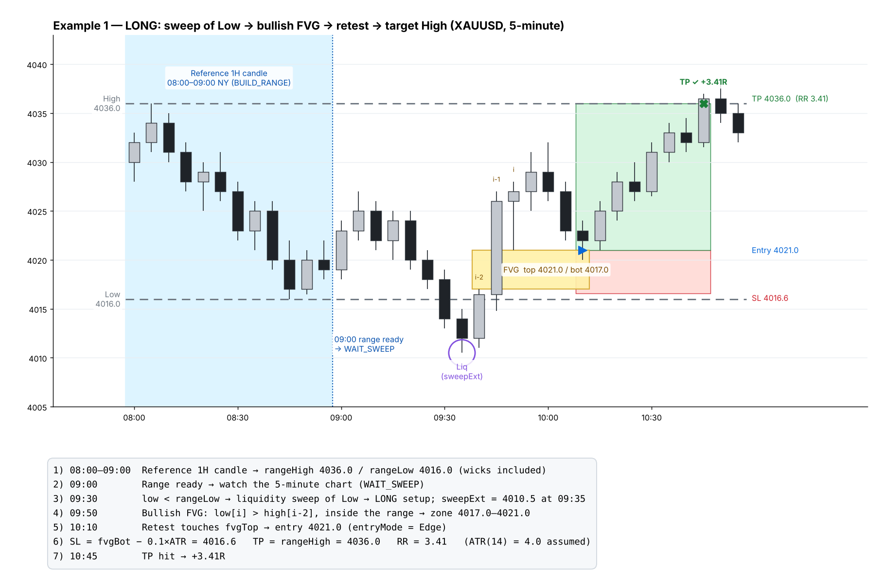
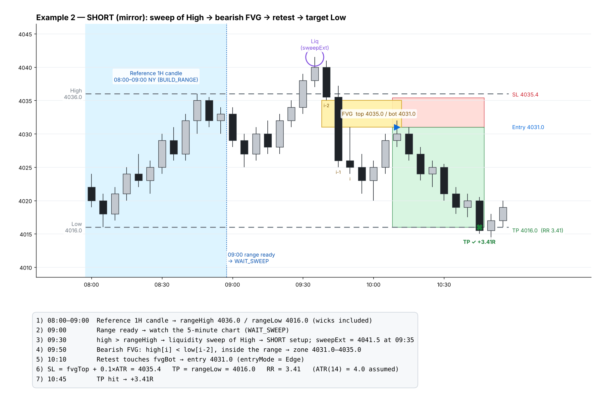
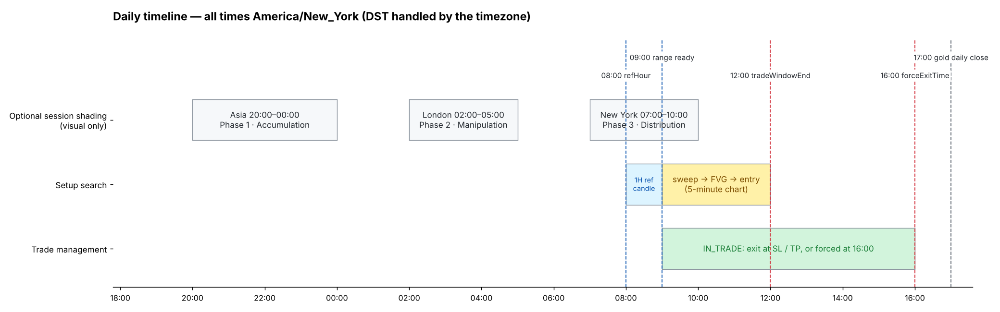
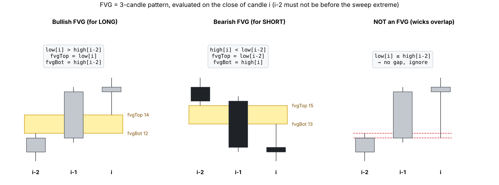
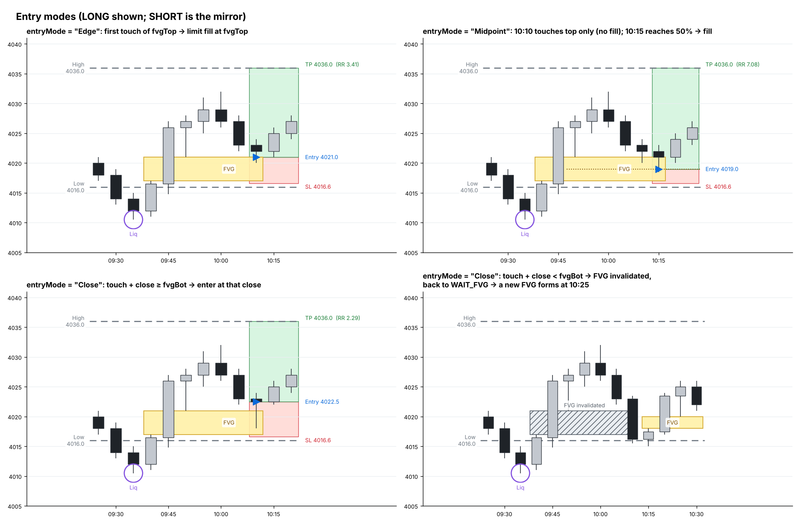
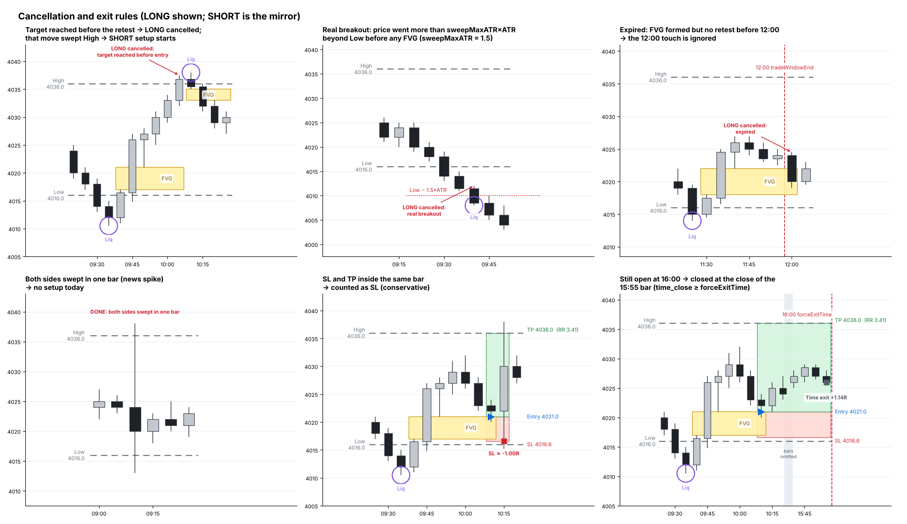
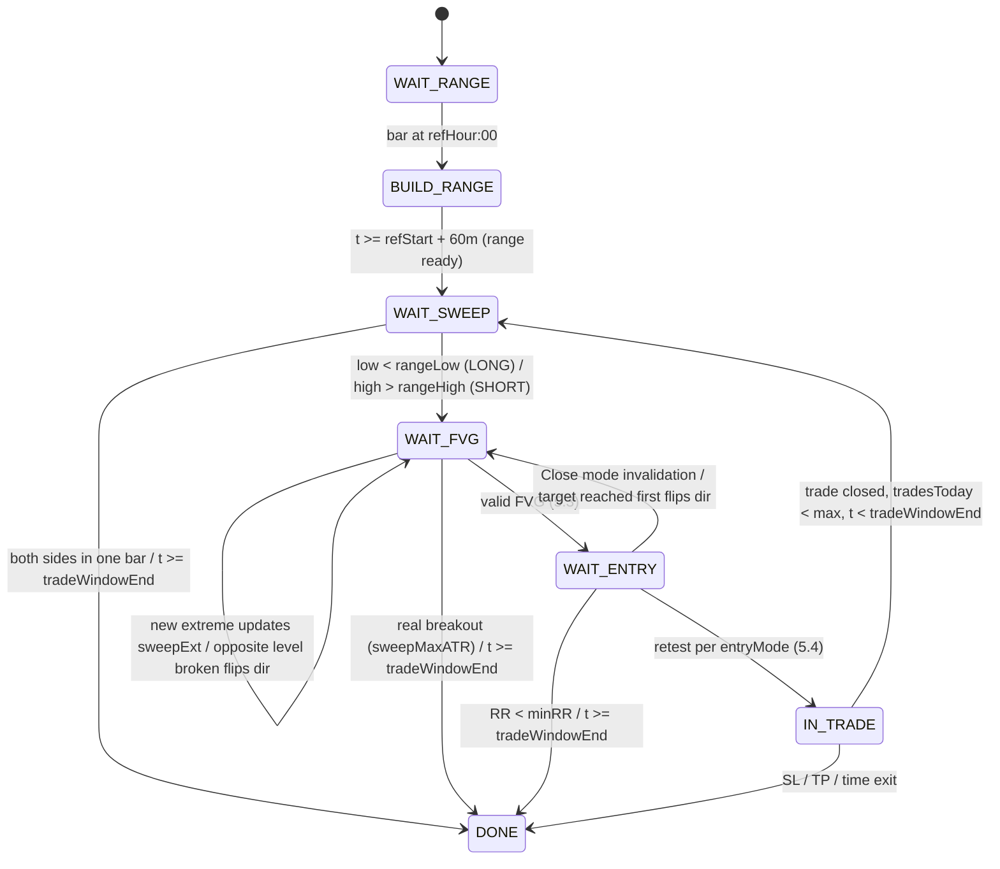

# مواصفات مؤشر: استراتيجية CRT للذهب (XAUUSD) على افتتاح نيويورك

> **طريقة الاستخدام:** انسخ هذا الملف كاملاً وأعطه لـ Claude Opus.
> القسم 11 هو الطلب الموجّه له مباشرة، وبقية الأقسام هي المواصفات التي يبني عليها.
>
> **الصور التوضيحية** موجودة في مجلد [`img/`](img/) ومدمجة في الأقسام المناسبة. الأسعار فيها افتراضية.
> كل علامة في الصور (السحب، الفجوة، الدخول، الوقف، الهدف، الإلغاء) محسوبة آلياً بالدالة `simulate` في
> [`img/generate_diagrams.py`](img/generate_diagrams.py)، وهي تطبيق مرجعي بلغة Python للقسمين 5 و6.
> إذا اختلفت الصورة عن النص، فالنص هو المرجع.

| الصورة | المحتوى |
|---|---|
| [`01-daily-timeline.png`](img/01-daily-timeline.png) | الجدول الزمني لليوم بتوقيت نيويورك |
| [`02-long-example.png`](img/02-long-example.png) | مثال شراء كامل خطوة بخطوة |
| [`03-short-example.png`](img/03-short-example.png) | مثال بيع (مرآة للشراء) |
| [`04-fvg-definition.png`](img/04-fvg-definition.png) | تعريف الـFVG الصاعدة والهابطة، ومثال ليس FVG |
| [`05-entry-modes.png`](img/05-entry-modes.png) | طرق الدخول الثلاث وإلغاء الفجوة |
| [`06-edge-cases.png`](img/06-edge-cases.png) | حالات الإلغاء والخروج الخاصة |

---

## 1. مصدر الاستراتيجية

- فيديو تيك توك مدته 57 ثانية لحساب «Crypto Expert | Adem OnChain».
- اسم الاستراتيجية في الفيديو: **CRT – Candle Range Theory**، مشروحة بنموذج المراحل الثلاث **AMD**:
  التجميع (Accumulation) ← التلاعب (Manipulation) ← التوزيع (Distribution).
- يختم صاحب الفيديو بعبارة «للتفاصيل الكاملة اكتب في التعليقات»، أي أنه لم يذكر كل التفاصيل.
  كل ما لم يُذكر صراحةً جعلته إعداداً قابلاً للتغيير، ووضعت عليه علامة **[افتراض]**، وجمعته في القسم 9.

### ما قيل وما ظهر في الفيديو (حسب التوقيت)

| الوقت | النص على الشاشة | ما يظهر على الشارت |
|---|---|---|
| 0:00–0:05 | «اليوم بنشرح استراتيجية… CRT – Candle Range Theory» | شمعتان كبيرتان ثم نطاق وكسر هابط |
| 0:06–0:08 | «الأشهر عند التريدرز، وهي تشتغل بثلاث مراحل» | ثلاثة أعمدة: Phase 1 / Phase 2 / Phase 3 |
| 0:09–0:15 | «المرحلة الأولى هي التجميع، السعر يتحرك في نطاق محدد والسمارت موني يبني مراكزه فيها» | علم اليابان (جلسة آسيا)، شموع داخل نطاق بين خطين متقطعين |
| 0:16–0:22 | «المرحلة الثانية هي التلاعب، السعر يسحب السيولة ويطرد التريدرز الضعفاء من السوق» | علم بريطانيا (جلسة لندن)، نزول تحت قاع النطاق مع كلمة **Liq** ثم ارتداد |
| 0:23–0:30 | «المرحلة الثالثة هي التوزيع، بعد سحب السيولة السعر يبدأ حركته الحقيقية» | علم أمريكا (جلسة نيويورك)، صعود قوي باتجاه واحد |
| 0:31–0:35 | «مثلاً، هذا شارت الذهب على إطار الساعة. أول شي نحدد الهاي واللو لأول شمعة…» | XAUUSD، فريم 1hr، عنوان **NY Open** |
| 0:36–0:38 | «…بعد افتتاح نيويورك» | خط **High** على أعلى ذيل الشمعة وخط **Low** على أدنى ذيلها، ممتدّان يميناً |
| 0:39–0:41 | «بعدين ننتقل لإطار الخمس دقائق وننتظر» | الشمعة الساعية على اليسار، وبعدها شموع 5 دقائق بين الخطين |
| 0:42–0:44 | «السعر يسحب السيولة من أحد المستويين» | شموع 5 دقائق تنزل تحت **Low** وتغلق تحته، مع دائرة **Liq** |
| 0:45–0:47 | «بعد سحب السيولة نحدد الـFVG…» | شمعة صاعدة قوية ترجع داخل النطاق وتترك **FVG** (مستطيل أصفر) فوق خط الـLow |
| 0:48–0:51 | «…وعند إعادة اختباره تكون نقطة دخولنا» | السعر يرجع وينزل داخل الـFVG |
| 0:52–0:54 | «الستوب لوس تحت الـFVG، والتارقت عند مستوى السيولة التالي» | صندوق رمادي للمخاطرة ينتهي تحت الـFVG بقليل، وصندوق للربح ينتهي عند خط **High** |
| 0:55–0:57 | «للتفاصيل الكاملة اكتب في التعليقات» | الصورة النهائية: السعر يصل إلى الـHigh |

---

## 2. فكرة الاستراتيجية باختصار

1. نأخذ **أول شمعة ساعة بعد افتتاح نيويورك**، ونحدد أعلى سعر لها (High) وأدنى سعر (Low) شاملاً الذيول. هذا هو «نطاق الشمعة» (Candle Range).
2. ننتقل إلى **فريم 5 دقائق** وننتظر حتى يكسر السعر أحد طرفي النطاق، وهذا هو **سحب السيولة (Liquidity Sweep)**.
3. بعد السحب يرجع السعر بقوة إلى داخل النطاق ويترك **فجوة قيمة عادلة (Fair Value Gap – FVG)**.
4. **ندخل عندما يرجع السعر لاختبار الـFVG.**
5. **وقف الخسارة خلف الـFVG**، و**الهدف هو الطرف المقابل من النطاق** (مستوى السيولة التالي).
6. البيع عكس ذلك تماماً: سحب الـHigh، ثم FVG هابطة، ثم بيع عند اختبارها، والوقف فوقها، والهدف عند الـLow.

علاقتها بمراحل AMD داخل يوم واحد:
النطاق = التجميع، والسحب = التلاعب، والحركة نحو الطرف الآخر = التوزيع.

| | إعداد شراء (Long) | إعداد بيع (Short) |
|---|---|---|
| السحب | السعر ينزل تحت **Low** | السعر يصعد فوق **High** |
| الفجوة | FVG صاعدة | FVG هابطة |
| الدخول | عند رجوع السعر إلى الـFVG من الأعلى | عند رجوع السعر إلى الـFVG من الأسفل |
| الوقف | تحت الحافة السفلية للـFVG | فوق الحافة العلوية للـFVG |
| الهدف | خط **High** | خط **Low** |

### مثال شراء كامل
الشمعة المرجعية 08:00–09:00، ثم سحب للـLow عند 09:30، ثم فجوة صاعدة عند 09:50، ثم دخول عند إعادة الاختبار 10:10، ثم وصول الهدف عند 10:45.



### مثال بيع (مرآة)
نفس المثال مقلوباً: سحب للـHigh، ثم فجوة هابطة، ثم بيع عند إعادة الاختبار، والهدف هو الـLow.



---

## 3. المنصة والفريم

- **TradingView، Pine Script v6**، ويُعرَّف بـ `indicator(..., overlay = true)`.
- الرمز: XAUUSD، ويجب أن يعمل مع أي وسيط.
- فريم التشغيل: **5 دقائق**. يجب أن يعمل أيضاً على 1 و3 و15 دقيقة (أي فريم من 1 إلى 15 دقيقة يقسم الـ60 دقيقة).
- إذا شُغّل على فريم غير مناسب، يعرض المؤشر رسالة تحذير على الشارت ولا يرسم إشارات.
- إذا أردت MetaTrader 5 بدلاً من TradingView: غيّر كلمة «Pine Script v6» في القسم 11 إلى «MQL5». بقية المنطق نفسه.

---

## 4. الإعدادات (Inputs)



### الجلسة والنطاق
| الإعداد | الافتراضي | الوصف |
|---|---|---|
| `tz` | `"America/New_York"` | المنطقة الزمنية لكل الأوقات. تعالج التوقيت الصيفي تلقائياً |
| `refHour` | `8` | ساعة بداية الشمعة المرجعية بتوقيت نيويورك (8 تعني شمعة 08:00 إلى 09:00) **[افتراض]** |
| `tradeWindowEnd` | `"12:00"` | إذا لم يحدث دخول قبل هذا الوقت يُلغى إعداد اليوم **[افتراض]** |
| `forceExitTime` | `"16:00"` | إغلاق أي صفقة ما زالت مفتوحة عند هذا الوقت **[افتراض]** |
| `maxTradesPerDay` | `1` | أقصى عدد صفقات في اليوم **[افتراض]** |
| `allowLong` / `allowShort` | `true` / `true` | تفعيل الشراء أو البيع |

### سحب السيولة
| الإعداد | الافتراضي | الوصف |
|---|---|---|
| `sweepMinDist` | `0.0` | أقل مسافة (بوحدة السعر) يجب أن يتجاوزها السعر خلف المستوى حتى يُحسب سحباً |
| `sweepMaxATR` | `0.0` (معطّل) | إذا ابتعد السعر خلف المستوى أكثر من `sweepMaxATR × ATR(14)` قبل تكوّن الفجوة، يُعتبر اختراقاً حقيقياً ويُلغى الإعداد **[افتراض]** |

### الفجوة (FVG) والدخول
| الإعداد | الافتراضي | الوصف |
|---|---|---|
| `fvgMinATR` | `0.1` | أقل حجم مقبول للفجوة = `fvgMinATR × ATR(14)`، لاستبعاد الفجوات الصغيرة جداً **[افتراض]** |
| `fvgInsideRange` | `true` | يجب أن تكون الفجوة كاملةً داخل النطاق (High/Low)، كما في مثال الفيديو **[افتراض]** |
| `entryMode` | `"Edge"` | طريقة الدخول: `"Edge"` أمر معلّق عند حافة الفجوة، أو `"Midpoint"` أمر معلّق عند منتصفها (50%)، أو `"Close"` دخول عند إغلاق شمعة لمست الفجوة ثم أغلقت داخلها أو فوقها (للشراء) **[افتراض]** |

### الوقف والهدف
| الإعداد | الافتراضي | الوصف |
|---|---|---|
| `slMode` | `"Beyond FVG"` | `"Beyond FVG"`: الوقف خلف الفجوة، كما في الفيديو. `"Beyond Sweep"`: الوقف خلف أقصى نقطة وصلها السحب |
| `slBufferATR` | `0.1` | هامش إضافي خلف الوقف = `slBufferATR × ATR(14)` **[افتراض]** |
| `tpMode` | `"Opposite Level"` | `"Opposite Level"`: الهدف هو الطرف المقابل من النطاق، كما في الفيديو. `"Fixed RR"`: الهدف بنسبة عائد ثابتة |
| `rrFixed` | `2.0` | نسبة العائد إلى المخاطرة عند اختيار `"Fixed RR"` |
| `minRR` | `0.0` (معطّل) | تجاهل الصفقة إذا كانت نسبة العائد إلى المخاطرة أقل من هذا الرقم |

### العرض
| الإعداد | الافتراضي | الوصف |
|---|---|---|
| `showRange` | `true` | خطّا High وLow مع أسمائهما |
| `showSweep` | `true` | علامة **Liq** عند نقطة السحب |
| `showFVG` | `true` | صندوق الفجوة باللون الأصفر الفاتح، كما في الفيديو |
| `showTrade` | `true` | صندوق المخاطرة (أحمر أو رمادي) وصندوق الربح (أخضر) |
| `showSessions` | `false` | خلفيات الجلسات الثلاث مع أسماء مراحل AMD، للتوضيح فقط |
| `asiaSess` / `londonSess` / `nySess` | `"2000-0000"` / `"0200-0500"` / `"0700-1000"` | أوقات الجلسات للرسم التوضيحي بتوقيت نيويورك **[افتراض]** |
| `showStats` | `true` | جدول الإحصاءات |
| `keepDays` | `20` | حذف رسومات الأيام الأقدم من هذا العدد، لتجنّب حدود الرسم في Pine |
| الألوان | — | إعداد لون لكل عنصر |

---

## 5. التعريفات الدقيقة

### 5.1 النطاق (Candle Range)
- **الشمعة المرجعية** هي شمعة الساعة التي تبدأ عند `refHour:00` بتوقيت `tz` كل يوم تداول.
- `rangeHigh` هو أعلى `high` فيها، و`rangeLow` هو أدنى `low` فيها، **شاملاً الذيول**.
- طريقة الحساب: تُجمَّع شموع الفريم الحالي التي يقع وقت بدايتها داخل `[refStart, refStart + 60 دقيقة)`. هذه الطريقة لا تحتاج `request.security`، وبالتالي لا يوجد خطر lookahead.
- يصبح النطاق **جاهزاً** فقط بعد إغلاق آخر شمعة داخل الساعة، أي عند أول شمعة يكون وقتها `>= refStart + 60 دقيقة`. لا يُبحث عن أي سحب قبل ذلك.

### 5.2 سحب السيولة (Sweep)
- **سحب سفلي (يبدأ إعداد شراء):** شمعة مؤكدة بعد جاهزية النطاق يتحقق فيها `low < rangeLow − sweepMinDist`.
- **سحب علوي (يبدأ إعداد بيع):** شمعة مؤكدة بعد جاهزية النطاق يتحقق فيها `high > rangeHigh + sweepMinDist`.
- **لا يُشترط** أن تغلق الشمعة داخل النطاق. في الفيديو أغلقت شموع السحب خارج الخط ثم عاد السعر بعدها.
- `sweepExt` هو أقصى نقطة وصلها السعر خلف المستوى (أدنى low للشراء، وأعلى high للبيع)، و`sweepExtBar` هو رقم شمعتها. **تُحدَّث القيمتان مع كل قاع جديد** (أو قمة جديدة) إلى أن تتكوّن الفجوة.
- إذا كسرت الشمعة نفسها الطرفين معاً (حالة نادرة)، يُلغى إعداد اليوم.

### 5.3 فجوة القيمة العادلة (FVG): نموذج الشموع الثلاث
عند الشمعة المؤكدة رقم `i`:
- **FVG صاعدة:** `low[i] > high[i-2]`، وحدودها: `fvgTop = low[i]` و`fvgBot = high[i-2]`.
- **FVG هابطة:** `high[i] < low[i-2]`، وحدودها: `fvgTop = low[i-2]` و`fvgBot = high[i]`.

تُقبل الفجوة فقط إذا تحققت كل هذه الشروط:
1. اتجاهها يوافق اتجاه الإعداد (صاعدة للشراء، وهابطة للبيع).
2. الشمعة الأولى في الفجوة (`i-2`) ليست قبل شمعة أقصى نقطة للسحب، أي `bar_index - 2 >= sweepExtBar`. هذا يضمن أن الفجوة تكوّنت أثناء الارتداد بعد السحب.
3. `fvgTop − fvgBot >= fvgMinATR × ATR(14)`.
4. إذا كان `fvgInsideRange` مفعّلاً: `fvgBot >= rangeLow` و`fvgTop <= rangeHigh`.

يُستخدم **أول** فجوة تحقق هذه الشروط بعد السحب.



### 5.4 الدخول (Retest)
يبدأ البحث من الشمعة التي تلي شمعة الفجوة `i`، **ولا تُحسب شمعة الفجوة نفسها**. الوصف هنا للشراء، والبيع عكسه:

| `entryMode` | شرط التفعيل | سعر الدخول |
|---|---|---|
| `"Edge"` | `low <= fvgTop` | `min(open, fvgTop)` |
| `"Midpoint"` | `low <= (fvgTop + fvgBot) / 2` | `min(open, mid)` |
| `"Close"` | `low <= fvgTop` و`close >= fvgBot` | `close` |

- في وضع `"Close"`: إذا لمست الشمعة الفجوة لكنها أغلقت تحت `fvgBot`، **تُلغى الفجوة** ونعود لانتظار فجوة جديدة (حالة `WAIT_FVG`).
- إذا وصل السعر إلى الهدف قبل الدخول (`high >= rangeHigh` للشراء)، يُلغى الإعداد. هذه الحركة هي سحب للطرف الآخر، فيمكن أن يبدأ منها إعداد بيع إذا كان `allowShort` مفعّلاً ولم يُستنفد عدد الصفقات.



### 5.5 الوقف والهدف (للشراء، والبيع عكسه)
- `"Beyond FVG"`: `SL = fvgBot − slBufferATR × ATR(14)`.
- `"Beyond Sweep"`: `SL = sweepExt − slBufferATR × ATR(14)`.
- `"Opposite Level"`: `TP = rangeHigh`.
- `"Fixed RR"`: `TP = entry + rrFixed × (entry − SL)`.
- `RR = (TP − entry) / (entry − SL)`. إذا كانت `RR < minRR`، أو كانت `RR <= 0` (أي أن الدخول فوق الهدف)، تُتجاهل الصفقة.

### 5.6 الخروج
- **الخسارة:** `low <= SL` للشراء، وتُحسب `−1R`.
- **الربح:** `high >= TP` للشراء، وتُحسب `+RR`.
- إذا تحقق الوقف والهدف في الشمعة نفسها، **يُحسب الوقف أولاً** (افتراض متحفظ).
- في شمعة الدخول نفسها **يُفحص الوقف فقط**، لأننا لا نعرف هل وصل السعر إلى الـhigh قبل الدخول أم بعده.
- **الخروج بالوقت:** الصفقة المفتوحة تُغلق على سعر `close` للشمعة التي **ينتهي** وقتها عند `forceExitTime` أو بعده (`time_close >= forceExitTime`). على فريم 5 دقائق هذه شمعة 15:55، فيكون الخروج عند 16:00 تماماً. النتيجة `R = (close − entry) / (entry − SL)`.



---

## 6. منطق المؤشر خطوة بخطوة (State Machine)

كل المنطق يعمل على الشموع المؤكدة فقط (`barstate.isconfirmed`).



```text
الحالات: WAIT_RANGE → BUILD_RANGE → WAIT_SWEEP → WAIT_FVG → WAIT_ENTRY → IN_TRADE → DONE
         (ويمكن الانتقال إلى DONE من أي حالة عند الإلغاء أو انتهاء الوقت)

عند كل شمعة مؤكدة:
  t = وقت بداية الشمعة بتوقيت tz

  # 1) بداية يوم جديد = بداية الشمعة المرجعية
  if t == اليوم عند refHour:00 (أو أول شمعة وقتها >= refHour:00 في هذا اليوم):
      صفّر كل متغيرات اليوم
      rangeHigh = high ; rangeLow = low ; tradesToday = 0
      state = BUILD_RANGE

  # 2) بناء النطاق
  elif state == BUILD_RANGE and t < refStart + 60min:
      rangeHigh = max(rangeHigh, high) ; rangeLow = min(rangeLow, low)

  if state == BUILD_RANGE and t >= refStart + 60min:
      ارسم خطي High/Low وأطلق تنبيه "Range ready"
      state = WAIT_SWEEP            # تُقيَّم هذه الشمعة نفسها في الخطوة 3

  # انتهاء نافذة البحث عن الإعداد
  if state in (WAIT_SWEEP, WAIT_FVG, WAIT_ENTRY) and t >= tradeWindowEnd:
      state = DONE (expired)

  # 3) انتظار السحب
  if state == WAIT_SWEEP:
      sweptLow  = allowLong  and low  < rangeLow  - sweepMinDist
      sweptHigh = allowShort and high > rangeHigh + sweepMinDist
      if sweptLow and sweptHigh: state = DONE (ambiguous)
      elif sweptLow:  dir = LONG ;  sweepExt = low ;  sweepExtBar = bar_index ; state = WAIT_FVG
      elif sweptHigh: dir = SHORT ; sweepExt = high ; sweepExtBar = bar_index ; state = WAIT_FVG

  # 4) انتظار الفجوة (هنا للشراء، والبيع عكسه)
  elif state == WAIT_FVG and dir == LONG:
      if low < sweepExt: sweepExt = low ; sweepExtBar = bar_index
      if sweepMaxATR > 0 and rangeLow - sweepExt > sweepMaxATR * atr: state = DONE (real breakout)
      elif high > rangeHigh:                 # السعر كسر الطرف المقابل
          if allowShort: dir = SHORT ; sweepExt = high ; sweepExtBar = bar_index   # يبقى في WAIT_FVG
          else: state = DONE
      elif low > high[2] and bar_index-2 >= sweepExtBar and الحجم مقبول and شرط داخل النطاق:
          fvgTop = low ; fvgBot = high[2] ; fvgBar = bar_index - 2
          ارسم صندوق FVG وأطلق تنبيه "FVG formed"
          state = WAIT_ENTRY

  # 5) انتظار إعادة الاختبار (هنا للشراء)
  elif state == WAIT_ENTRY and dir == LONG and bar_index > fvgBar + 2:
      if high >= rangeHigh: الإعداد يُلغى (الهدف تحقق بدون دخول). إذا كان البيع مسموحاً: dir = SHORT ; sweepExt = high ; sweepExtBar = bar_index ; state = WAIT_FVG
      elif تحقق شرط الدخول حسب entryMode:
          احسب entry و SL و TP و RR (القسم 5.5)
          if RR <= 0 or RR < minRR: state = DONE (skipped)
          else:
              tradesToday += 1 ; ارسم صندوقي المخاطرة والربح ; أطلق تنبيه "Entry"
              state = IN_TRADE
              if low <= SL: سجّل خسارة → إنهاء الصفقة   # فحص الوقف في شمعة الدخول
      elif entryMode == "Close" and low <= fvgTop and close < fvgBot:
          ألغِ الفجوة ; state = WAIT_FVG

  # 6) إدارة الصفقة (هنا للشراء)
  elif state == IN_TRADE:
      if low <= SL:            سجّل خسارة (-1R)
      elif high >= TP:         سجّل ربحاً (+RR)
      elif time_close >= forceExitTime: أغلق على close وسجّل R الفعلي
      عند انتهاء الصفقة:
          if tradesToday < maxTradesPerDay and t < tradeWindowEnd: state = WAIT_SWEEP
          else: state = DONE
```

---

## 7. الرسم على الشارت

1. **النطاق:** خطان متقطعان رماديان من بداية الشمعة المرجعية حتى `tradeWindowEnd` (أو حتى نهاية الصفقة إن كانت أبعد)، مع كلمة `High` فوق الخط العلوي وكلمة `Low` تحت الخط السفلي، وكلمة صغيرة `NY Open` عند بداية الشمعة المرجعية.
2. **السحب:** كلمة `Liq` تحت أقصى نقطة للسحب السفلي (أو فوق أقصى نقطة للسحب العلوي). يمكن أن تكون داخل دائرة كما في الفيديو.
3. **الفجوة:** صندوق أصفر فاتح شفاف يبدأ من الشمعة `i-2` ويمتد يميناً حتى الدخول أو الإلغاء أو `tradeWindowEnd`، وفي داخله كلمة `FVG`.
4. **الصفقة:** صندوق للمخاطرة من سعر الدخول إلى الوقف، وصندوق للربح من سعر الدخول إلى الهدف، وكلاهما يمتد من شمعة الدخول حتى شمعة الخروج. بجانبهما label فيه سعر الدخول والوقف والهدف ونسبة RR.
5. **النتيجة:** علامة عند الخروج: `TP ✓` باللون الأخضر، أو `SL ✗` باللون الأحمر، أو `Time` باللون الرمادي.
6. **الجلسات (اختياري):** خلفيات خفيفة لجلسات آسيا ولندن ونيويورك، مكتوب عليها `Accumulation` و`Manipulation` و`Distribution`.
7. **جدول الإحصاءات** في الزاوية العلوية اليمنى، ويعرض: عدد الأيام، عدد الإعدادات، عدد الصفقات، الرابحة، الخاسرة، الخروج بالوقت، نسبة النجاح، مجموع R، متوسط R لكل صفقة.
8. **حدود Pine:** يُضبط `max_boxes_count`، و`max_lines_count`، و`max_labels_count` على 500، وتُحذف رسومات الأيام الأقدم من `keepDays`.

---

## 8. التنبيهات (Alerts)

تُطلق باستخدام `alert()` مرة واحدة عند إغلاق الشمعة، ويكون النص بصيغة JSON بسيطة أو نص واضح يتضمن الرمز والاتجاه والأسعار:
- `Range ready`: يتضمن High وLow.
- `Sweep`: يتضمن الاتجاه المتوقع وسعر السحب.
- `FVG formed`: يتضمن حدّي الفجوة.
- `Entry`: يتضمن الاتجاه وسعر الدخول وSL وTP وRR.
- `TP hit` / `SL hit` / `Time exit`: يتضمن نتيجة R.

ويضاف أيضاً `alertcondition` لكل حدث، ليستطيع المستخدم اختيار التنبيه من قائمة TradingView.

---

## 9. الافتراضات: أشياء لم يحددها الفيديو

| # | الموضوع | ما قاله الفيديو | الافتراضي المختار | السبب |
|---|---|---|---|---|
| 1 | ساعة الشمعة المرجعية | «أول شمعة بعد افتتاح نيويورك» فقط | 08:00 بتوقيت نيويورك (`refHour = 8`) | خيار شائع لـ CRT مع الذهب. الإعداد قابل للتغيير إلى 9 أو غيرها. ملاحظة: افتتاح الأسهم 09:30 ليس بداية شمعة ساعة على TradingView |
| 2 | المنطقة الزمنية | — | `America/New_York` | تجنّب اختلاف توقيت الوسيط وتغيّر التوقيت الصيفي |
| 3 | شرط السحب | «يسحب السيولة من أحد المستويين» | الكسر بالذيل يكفي، ولا يُشترط إغلاق الشمعة داخل النطاق | في الفيديو أغلقت شموع السحب خارج الخط ثم ارتد السعر |
| 4 | مكان الفجوة | — | داخل النطاق (`fvgInsideRange = true`) | الفجوة في المثال فوق خط الـLow بالكامل |
| 5 | حجم الفجوة | — | `0.1 × ATR(14)` حداً أدنى | لاستبعاد الفجوات الصغيرة جداً |
| 6 | الدخول | «عند إعادة اختباره» | أول لمس لحافة الفجوة (`"Edge"`) | أبسط تفسير، مع خيارين بديلين |
| 7 | الوقف | «تحت الـFVG» | تحت الحافة السفلية بهامش `0.1 × ATR(14)` | في الرسم ينتهي صندوق المخاطرة تحت الفجوة بقليل |
| 8 | الهدف | «عند مستوى السيولة التالي» | الطرف المقابل من النطاق | في المثال انتهى صندوق الربح عند خط الـHigh |
| 9 | مدة صلاحية الإعداد | — | حتى 12:00، والإغلاق الإجباري للصفقة 16:00 | منع إشارات متأخرة جداً في نهاية اليوم |
| 10 | عدد الصفقات | — | صفقة واحدة يومياً | الفيديو يعرض صفقة واحدة |
| 11 | أوقات الجلسات (للرسم فقط) | أعلام آسيا ولندن ونيويورك | 20:00–00:00 و02:00–05:00 و07:00–10:00 | توضيحية فقط ولا تؤثر على الإشارات |
| 12 | الوقف والهدف في الشمعة نفسها | — | يُحسب الوقف | افتراض متحفظ في الإحصاءات |

> نصيحة: الفيديو يطلب كتابة تعليق للحصول على «التفاصيل الكاملة». إذا حصلت على إجابة من صاحب الفيديو، خصوصاً عن ساعة الشمعة وشرط الدخول، فعدّل الافتراضات في هذا الجدول قبل إرسال الملف.

---

## 10. معايير القبول (كيف نتأكد أن المؤشر صحيح)

1. الكود يُترجم في Pine Script v6 بدون أخطاء.
2. **بدون إعادة رسم (No repaint):** كل الإشارات والرسومات تعتمد على شموع مؤكدة. إعادة تحميل الشارت لا تغيّر أي إشارة سابقة. لا يُستخدم `lookahead_on`.
3. على فريم 5 دقائق، خطّا High وLow يطابقان تماماً شمعة الساعة 08:00 بتوقيت نيويورك على فريم 1H.
4. الأوقات صحيحة قبل وبعد تغيير التوقيت الصيفي (مارس ونوفمبر).
5. يعمل على فريمات 1 و3 و5 و15 دقيقة. على فريم أكبر من 15 دقيقة تظهر رسالة تحذير.
6. منطق البيع مرآة دقيقة لمنطق الشراء.
7. الأيام التي لا تحتوي بيانات (عطلات أو بيانات ناقصة) لا تسبب أخطاء.
8. أرقام جدول الإحصاءات تطابق العلامات المرسومة على الشارت.
9. لا يتجاوز المؤشر حدود الرسم في Pine عند فتح تاريخ طويل.
10. سلوك المؤشر يطابق الحالات المرسومة في الصور 02 إلى 06: النتيجة نفسها لكل حالة (دخول، أو إلغاء، أو SL، أو TP، أو خروج بالوقت).

---

## 11. الطلب الموجّه لـ Claude Opus

```text
أنت مطوّر محترف في Pine Script v6 على TradingView.
ابنِ مؤشراً (indicator, overlay=true) للذهب XAUUSD ينفّذ استراتيجية CRT الموصوفة
في هذا الملف بالكامل، ملتزماً بالأقسام 4 إلى 8 كما هي.
افتح كل الصور في docs/img/ وادرسها قبل الكتابة، فهي أمثلة محلولة للقواعد.
والدالة simulate في docs/img/generate_diagrams.py تطبيق مرجعي بلغة Python لنفس المنطق،
استخدمها لفهم ترتيب الفحوصات داخل كل شمعة.

المطلوب:
1. كود Pine Script v6 كامل في ملف واحد، منظّم في أقسام بتعليقات واضحة:
   Inputs، حساب النطاق، State machine، الرسم، التنبيهات، الإحصاءات.
2. استخدم الإعدادات والقيم الافتراضية في القسم 4 بنفس الأسماء، مع group و tooltip لكل إعداد.
3. طبّق State machine الموجود في القسم 6 حرفياً، ومنطق البيع مرآة للشراء.
4. التزم بمعايير القبول في القسم 10، خصوصاً عدم إعادة الرسم وصحة التوقيت.
5. بعد الكود اكتب:
   - شرحاً مختصراً لكل قسم في الكود.
   - قائمة بأي افتراض إضافي اضطررت إليه وليس مذكوراً في القسم 9.
   - طريقة اختبار يدوية سريعة على شارت XAUUSD فريم 5 دقائق.
6. إذا وجدت تعارضاً أو ثغرة في المواصفات، اذكرها واقترح حلاً، ولا تغيّر المنطق بصمت.

بعد أن أختبر المؤشر، سأطلب منك نسخة strategy() من نفس المنطق للباك تست.
```

---

> **تنبيه:** هذه المواصفات تحوّل شرح الفيديو إلى قواعد قابلة للبرمجة، ولا تضمن ربحية الاستراتيجية.
> اختبرها على بيانات تاريخية وعلى حساب تجريبي قبل استخدامها بأموال حقيقية.
